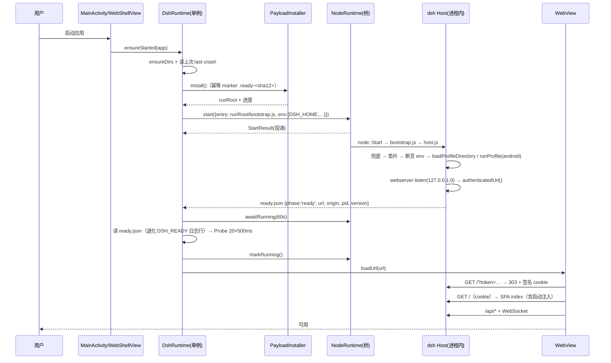

# DSH Desktop · Android 版 — 工程规划

> 文档编号：`docs/000-工程规划.md`
> 版本：v0.1（规划稿）
> 状态：**规划中**（未开工；P0 门禁未验证）
> 日期：2026-10-27
> 上游基线：`deepseek-harness` **tag = `dsh-v0.2.1-rc.2`**（`@deepseek-ai/dsh` 0.2.1-rc.2，`engines.node = ^22.19.0 || >=24.0.0`）
> 运行时基线：`aosp-node-runtime` **Node v24.22.1**（`libnode.so` 71,070,040 B，`sha256 f6a1610a…`，`pageAlign16k = true`；二进制不入库）
> 桥基线：`aosp-node-bridge` **0.2.0**（Maven `io.github.fellow99:node-bridge`；JNI 引导件 + NAPI addon + JSON 槽位表）
> 参考工程：`dsh-desktop-ark`（**同构基线**：ArkWeb + 进程内 Node）、`dsh-desktop-hos`（Electron on HarmonyOS，能力对标源）、`dsh-desktop`（Electron 桌面壳，壳契约源）、`dsh-market`（插件市场，1.67.0）

---

## 0. 速览（一页纸）

**做什么**：在 Android 上交付 DeepSeek Harness（dsh）的桌面级客户端。UI **100% 复用上游 dsh Web 前端**（不改 UI、不 fork），Host 是**真正的 Node.js**（进程内 `System.loadLibrary("node")` + `dlopen` + `node::Start`），渲染用**系统 WebView**。不打包 Chromium、不写原生聊天界面、不改上游源码。

**能力目标**：与 `dsh-desktop-ark` 0.2.1 **功能对齐**——对话/工具调用、**命令执行**（`/system/bin/sh`）、文件读写与**纯 JS 内容搜索**、会话持久化与 SQLite 全文搜索、图片附件、**三主目录工作区**（沙箱/文档/下载，桌面存在时多一个）、系统通知、**git 21 个工具**（纯 JS）、**运行时插件安装**（内置纯 JS pnpm）、**dsh-market 插件市场**、诊断取证；以「自分发 APK」为第一交付目标，Google Play 作为**可选**发行线（`store` flavor）。

**核心机制（三条）**

1. **同源数据面**：Node 内启动 dsh Host（`webserver` 绑 `127.0.0.1:0`）→ 拿 `authenticatedUrl` → WebView `loadUrl()` 同源加载 → `?token=` 换签名 cookie → 页面走 `/api` + WebSocket。**零 CORS、零头改写、零自定义协议、零 cookie 注入**。
2. **适配层在上游扩展点里**：新增 `android` profile + 自有 bundle（YAML patch 层），把 dsh 的能力 seam（`ctx.subprocess` / `ctx.shell` / `ctx.sandbox` / `ctx.directoryPicker` / `ctx.fs` / `ctx.tools`）换成 Android 实现。上游 **零源码补丁** 为目标，平台性缺陷只走**带标记的 4 条载荷垫片**。
3. **宿主能力走 JNI 桥**：Node ⇄ Kotlin 用 `@aosp-node-bridge` 的槽位表（JSON 进出、`anb_host_call` 同步等待、10 s 硬超时）；**不向网页注入 preload**，桌面能力全部由 Host 侧 seam 插件经桥提供。

**与 `dsh-desktop-ark` 的五条本质差异（决定哪些结论不能平移）**

| # | 面 | ark（鸿蒙） | 本工程（Android） | 设计后果 |
|---|---|---|---|---|
| 1 | 桥 | 文件信箱（NAPI 不可用） | **JNI 槽位表**（同步、10 s 超时、8 槽、8 KiB/64 KiB 上限） | 异步能力（系统选择器）必须**两段式**，不能阻塞等用户（§6.4） |
| 2 | 载荷 | `resfile` 真路径 → Node 自解包 | `assets` 不是路径 → **Kotlin 解包** | 少一条「谁写谁读」纪律，多一步首启解包（§7.4） |
| 3 | 链接 / 子进程 | 禁 symlink/hardlink、禁 spawn | **两者都可用** | 垫片从 6 条降到 4 条；`shell`/`subprocess` 可用原生语义（§5.3） |
| 4 | 用户目录 | ACL 受限、桌面已移除 | **All-files access**（`MANAGE_EXTERNAL_STORAGE`） | 路径模型与桌面版一致（§8.2）；代价是 Play 政策（§12） |
| 5 | 后台 / 生命周期 | 后台封死、`node::Start` 只能一次 | **前台服务可行**；Activity 会被重建 | 可做「agent 运行期保活」；必须建模 Activity 重建与 WebView 渲染进程崩溃（§4.5） |

**已定方向（用户 2026-10-27 拍板，详见 §14）**：分发以自分发为主（Play 后续可选）；存储用 All-files + 路径模型；Node **进程内**；`phone + tablet`、`minSdk 29`/`targetSdk 36`；Node 侧包**复制 ark 并改名 `@dsh-android/*`**。

**最大风险**：`node:sqlite` 是否含 FTS5（G2）、libnode 构建为 `--with-intl=none` 导致**没有 `Intl`**（G4）、载荷 pnpm 在 worker 里能否装通（G6）。三者列为 **P0 门禁**，先做 spike 再定版；All-files 的 Play 政策面单列 §12.2（只影响 `store` 发行线，不阻塞首期）。

---

## 1. 项目概述

### 1.1 一句话定位

`dsh-desktop-android` 是 **DSH Desktop 的 Android Edition**：Kotlin（Activity + 系统 WebView + 系统能力）负责窗口与平台能力，进程内 Node（`libnode.so` / `node::Start`）负责 dsh Host，两者通过 JNI 薄桥连接，业务数据全部走 loopback HTTP + WebSocket。它与 `dsh-desktop-ark`（HarmonyOS Edition）**架构同构、设计可互译**，差别只在「谁提供窗口」与「谁提供 Node 加载器」。

### 1.2 与既有工程的关系

| 工程 | 定位 | 与本工程的关系 |
|---|---|---|
| `deepseek-harness`（子模块，tag `dsh-v0.2.1-rc.2`） | 上游产品与运行时 | **唯一上游**。只消费其 `bundle` / `profile` / seam 扩展点与公开 API；不在源码里留改动 |
| `aosp-node-bridge`（0.2.0，Maven Central） | Kotlin API + JNI 引导件 + NAPI addon + 载荷引导 | **运行时依赖**。提供 `NodeRuntime` / `NodeState` / `host.register` / 崩溃取证 / stdio 重建 |
| `aosp-node-runtime`（24.22.1，Maven Central） | `libnode.so` + `libc++_shared.so` | **引擎依赖**。`runtimeOnly`，版本号 = Node 版本；`runtime.lock.json` 是唯一事实源 |
| `dsh-desktop-ark`（0.2.1） | dsh 的 HarmonyOS 版（ArkWeb + 进程内 Node） | **同构基线 + 资产源**：seam 插件、bundle 覆盖层、垫片、载荷管线、市场/pnpm/git 设计**逐份移植**，平台相关部分重写 |
| `dsh-desktop-hos` | dsh 的 Electron on HarmonyOS 版 | **能力对标基线 + 踩坑词典**（它的 Electron 主进程能力面 = 我们要用 Kotlin 补齐的能力面） |
| `dsh-desktop` | Electron 桌面版 | **壳契约参考**：`apps/desktop-host/src/index.ts` 的启动/就绪/关闭语义是 `payload/host.js` 的直接蓝本 |
| `dsh-market`（1.67.0） | 插件市场前端/索引 | 随载荷内置，走 dsh 插件管理器（`desktopProfiles` / `desktopPnpm` 契约） |

### 1.3 目标与非目标

**目标（按优先级）**

1. 真机跑通完整 dsh Web UI：新建会话 → 流式回复 → 工具调用可视化 → 重启后会话仍在。
2. 能力对齐 `dsh-desktop-ark` 0.2.1（见 §9 矩阵），差异逐条登记而非「看起来能用」。
3. 上游零源码补丁；升级上游 tag 只需重跑产物管线 + 回归。
4. 三条一等公民能力：**git**（21 工具）、**pnpm**（运行时装插件）、**dsh-market**（装/卸闭环）。
5. 保留 Play 上架的可能性（`store` flavor + 政策清单），但不作为首期阻塞。

**非目标（本期明确不做）**

- 不 fork / 不改写 dsh Web 前端，不做 Jetpack Compose 原生聊天界面。
- 不做 x86_64 / 模拟器形态（引擎只有 `arm64-v8a`）；不做 armeabi-v7a。
- 不做 PTY 真终端（首期；后续作为可选）。
- 不做内核级进程沙箱（Android 无 landlock 可用面；只做策略层）。
- 不自建 Node 交叉编译链（沿用 `aosp-node-runtime` 的 Actions 流水线，必要时才重编）。
- 不做多实例/多窗口；`launchMode="singleTask"`。
- 不做运行期下载 `.so`（合规红线，见 §12）。

### 1.4 术语

| 术语 | 含义 |
|---|---|
| Host | dsh 的 Node 侧应用（`runProfile` 返回的 Cordis 应用），提供 `webserver` + `/api` + `connection` |
| profile | 具名组装（`$DSH_HOME/profiles/<name>`）；本工程新增 `android` |
| bundle | 组合包：`package.json#dsh.bundle.patch` 指向的 YAML patch 层 |
| seam | 可替换能力（`ctx.subprocess`、`ctx.shell`、`ctx.sandbox`、`ctx.directoryPicker`…） |
| 载荷（payload） | 随 APK 分发的 Node 侧产物：dsh 生产依赖树 + `android` profile + 本工程插件 + pnpm + dshmarket |
| 垫片（shim） | 在 Node 入口最早期安装的运行时补丁，抹平平台缺陷；**必须带标记与自检** |
| 宿主桥 | Node ⇄ Kotlin 的 RPC 通道（`@aosp-node-bridge` 的槽位表 + `anb_host_call`） |
| 两段式调用 | 异步宿主能力的协议：首次 `invoke` 返回 `{pending:true,id}`，随后轮询 `host.result` 取结果（§6.4） |

---

## 2. 事实基础（读码/读文档结论，不是设想）

> 本节每条可回溯到源码或真机记录；后续设计只允许在此事实上推导。标 ⬜ 者是**尚未验证**、由 P0 门禁回答的问题。

### 2.1 上游启动模型（`dsh-v0.2.1-rc.2`）

- 运行中的 `dsh` 是一棵 Cordis 插件树；**profile** 列出有序组合包，**bundle** 通过 `package.json#dsh.bundle.patch` 声明 patch 文件。
- 应用入口只有 `dsh` launcher + 具名 profile（`web` / `headless` / `sdk` / `sdk-minimal` / `acp`）；桌面端是「Electron 壳 + 私有 Host + web profile」。
- 桌面 Host 的真实启动调用（`apps/desktop-host/src/index.ts`）：

  ```ts
  const profile = loadProfileDirectory('dsh', projectDir, installAnchor)   // 已初始化的 profile 目录
  reportSkippedBundles('dsh', profile)
  const application = runProfile({
    environment: loadLayeredEnv('dsh'),
    profile: 'desktop',
    resolvedProfile: { profile, installAnchor },
    patchFiles: [],
    args: ['--no-open', '--host', '127.0.0.1', '--port', '0'],
  })
  ```

- 就绪上报（同一文件）：`ctx.connection.authenticatedUrl(\`${ctx.webServer.protocol}//127.0.0.1:${ctx.webServer.port}\`)` → `http://127.0.0.1:<port>/?token=<一次性令牌>`。
- **鉴权模型**：每进程一个随机启动令牌；`GET /?token=…` → `ctx.connection.authorizeIndex` → **303 + 绑定 host:port 的签名 cookie**（`HttpOnly` / `SameSite=Strict`）；静态资源公开，其余未授权 401；特权方法额外要求 loopback authority。
- **能力 seam 是官方扩展点**：`ctx.shell`（命令执行）、`ctx.subprocess`（进程）、`ctx.sandbox`（隔离）、`ctx.directoryPicker`（目录选择）、`ctx.fs`（文件）、`ctx.tools`（工具）、`ctx.credentials`、`ctx.terminals`、`ctx.jobs`…
- **可选页内桥**：`__DSH_LOCALE__` / `__DSH_HOST_PATHS__` / `__DSH_DIRECTORY_PICKER__` 都可缺失；缺失时客户端回落 `ctx.uiWorkspace.pickDirectory()`（Host RPC）。**因此本工程不需要向网页注入任何 preload。**
- Agent 生命周期（`docs/agent-lifecycle.zh.md`）：`followup` → `agent/inbox/*` → `turn/start` → `step/start` → `system/message` / `user/message` → `llm/stream` → 工具调用（`tool/call` → `tool/result`）→ `step/end` → … → `turn/end`。**实时控制面在 `agent/*`，可回放事实在 `session/event`**——本工程的诊断与通知插件都只消费这两类事件，不碰循环内部。

### 2.2 桌面壳契约（本工程直接对齐）

| 契约 | Electron 桌面 | ark（鸿蒙） | **本工程（Android）** |
|---|---|---|---|
| 启动 | `spawn(electron, [host.js])` | `NodeRuntime.start(...)`（投递） | `NodeRuntime.start(...)`（投递，JNI） |
| 就绪 | `process.send({type:'ready',…})` | `ready.json` + `DSH_READY` 日志行 | **同 ark**：`ready.json` + `DSH_READY` + HTTP 探活 |
| 页面加载 | `loadURL('dsh-app://app/')` + fetch 转发 | `webview.loadUrl(authenticatedUrl)` | `WebView.loadUrl(authenticatedUrl)`（同源，无转发） |
| 注入 | `webContents` + IPC | 不需要（`injections` 由 `frontend-static` 渲染） | **不需要** |
| 桌面能力 | 主进程 `Tray`/`Notification` + preload | seam 插件 → 文件信箱 → ArkTS | seam 插件 → **JNI 桥** → Kotlin |
| 关闭 | IPC → `application.shutdown.shutdown(0)` | `NodeRuntime.shutdown()` + `host.dispatch('shutdown')` | **同 ark** |
| 致命错误 | `{type:'fatal', message, diagnostic}` | `ready.json(phase/error)` + `last-crash.json` + hilog | `ready.json` + `last-crash.json` + logcat |

### 2.3 运行时与桥（`aosp-node-bridge` 0.2.0）

**形态**：`libnode_bridge.so`（JNI，只链 `libc/libdl/liblog`）+ 进程内 `dlopen`/`dlsym` `node::Start`，跑在应用**自己的进程**内 detached pthread（32 MB 栈）；另有 `libnode_host_client.so`（NAPI addon，`DT_NEEDED libnode.so`）作为 Node 侧入口。

| API | 语义 |
|---|---|
| `NodeRuntime.getInstance(ctx)` | 进程内单例 |
| `start(NodeRuntimeOptions)` | **投递即返回**；`ok=true` 只代表线程已创建 |
| `state: StateFlow<NodeState>` | `Idle / Starting / Running / Failed / Stopping / Stopped / **Exited**` |
| `awaitRunning(timeoutMs)` | 带超时轮询；**不能 join** |
| `markRunning()` / `markFailed(reason)` | **由消费方判定业务就绪**（库不认识端口） |
| `logs()` / `lastCrash()` / `stage` / `lastError` | 观测面 |
| `shutdown(reason)` | 只触发 Node 侧钩子；**真正的停止只能是进程退出** |
| `host.register(name) { json -> json }` | 宿主能力注册；handler 在**主线程**执行；**只有同步版** |
| `host.dispatch(name, args)` | 未注册 → `{"ok":false,"error":"unregistered"}`；handler 抛异常 → `{"ok":false,"error":"handler-threw"}` |
| Node 侧 `require('./host.js').invoke(name, payload)` | `anb_host_call` 同步等待，**10 s 硬超时**（`ANB_TIMEOUT_MS`） |

**硬约束（实测/读码，不可协商）**

1. `node::Start` **每进程只能一次**；崩溃/退出即终态 → UI 只能「重启应用」，不能「重启服务」。
2. **`Exited` 必须显式建模**：Android 上 `process.exit(0)` 不杀 App，`node::Start` 返回后运行时会永久死亡（状态仍 running 是最难查的故障）。
3. 主线程绝不做 `dlopen`/`node::Start`（ANR 5 s/10 s/20 s）；库已用 detached 线程。
4. `execArgv` 启动即冻结；传不存在的 flag（如 Node 18 的 `--no-verify-heap`）会让 Node 1 ms 内返回 rc=9。
5. stdio 由库重建（fd0→`/dev/null`，fd1/2→pipe + reader 线程）→ 业务日志必须写**自有文件**。
6. 崩溃 handler 内只 `write(2)`；`last-crash.json` 只是**第二证据源**，system tombstone 仍在。
7. 槽位表：**8 槽**、name ≤ 128 B、args ≤ 8 KiB、result ≤ 64 KiB、**10 s 硬超时**。宿主能力的单次返回必须小于 64 KiB。
8. 库不参与渲染：WebView、加载页、错误页、cookie、导航围栏、`networkSecurityConfig` 全是消费方的事。
9. 库的 `materializeBuiltinPayload` 只物化 **AAR 自带的 3 个 JS**（`bootstrap.js`/`host.js`/`selfcheck.js`）；**不实现** tar.gz 归档解包 ⇒ 大载荷解包由本工程负责（§7.4）。

**引擎事实（`aosp-node-runtime/runtime.lock.json`）**：Node **24.22.1**，`arm64-v8a`，71,070,040 B，`sha256 f6a1610a…`，`ET_DYN` / 无 `PT_INTERP` / `SONAME libnode.so` / 导出 `_ZN4node5StartEiPPc` / **16 KB 页对齐**；`libc++_shared.so` 1,253,544 B 由同包供给；configure 为 `--dest-cpu=arm64 --dest-os=android --openssl-no-asm **--with-intl=none** --cross-compiling --shared`。

> ⚠️ `--with-intl=none` 意味着引擎内**没有 ICU**：`Intl` 未定义、`toLocaleString` 走默认实现。上游 Host 侧代码几乎不用 `Intl`（61 处命中里绝大多数在 client 包，运行在 WebView 里），但**第三方依赖**（pnpm / dshmarket / isomorphic-git）未逐个体检 ⇒ **G4 门禁**。

### 2.4 Android 平台事实（与设计直接相关）

| # | 事实 | 对设计的影响 |
|---|---|---|
| A1 | `assets/` 只在 APK zip 内，**不是文件系统路径** | 载荷必须解包到 `filesDir`（Kotlin 侧，`AssetManager` 流式读） |
| A2 | `minSdk 24`（库）· 本工程取 **29** | 可用 `ImageDecoder`(28+)、`Environment.isExternalStorageManager`(30+，需 29 兼容分支)、Scoped Storage 语义确定 |
| A3 | Android 9+ 默认禁明文 HTTP | 必须 `networkSecurityConfig` 对 `127.0.0.1` / `localhost` 显式放行；`base-config` 保持禁明文 |
| A4 | 系统 WebView 可独立升级，但**版本碎片** | 需设 WebView 下限（Chrome 110+）并在低于下限时**如实报错**（G-WV） |
| A5 | Activity 会因旋转/分屏/主题变化被重建 | `DshRuntime` 必须是 **Application 级单例**；WebView 重新挂载并重放 URL |
| A6 | WebView 渲染进程可能被杀（`onRenderProcessGone`） | 必须重建 WebView，**不得**当成 Host 崩溃 |
| A7 | 后台进程会被 LMK 杀 | 会话运行期用**前台服务**保活（§6.6）；类型与政策见 §12 |
| A8 | 应用私有目录支持 symlink / hardlink / flock 语义正常 | ark 的 `fs.link` / `fs.symlink` 垫片**不需要** |
| A9 | `/system/bin/sh` + toybox 存在，应用域可 `exec` 系统二进制 | `ctx.shell` / `ctx.subprocess` 走原生 spawn；**不得** exec 应用私有目录里的 ELF（Android 10+ W^X） |
| A10 | App 数据目录里的 ELF 不可执行（API 29+） | pnpm **不能** spawn 自带 node；只能在 worker 线程内跑 JS |
| A11 | `MANAGE_EXTERNAL_STORAGE` 需用户在系统设置里手动授予 | 权限门必须「先查后请」+ 跳设置页 + 授权后自愈（§6.8） |
| A12 | `getExternalStorageDirectory()` = `/storage/emulated/0`，`/sdcard` 是同一位置的别名 | 用户根**由 Kotlin 解析后经 env 下发**，Node 侧禁止自行猜测 |
| A13 | 无 `git` / `rg` / `fd` 二进制 | git 用 isomorphic-git；内容搜索用纯 JS 后端 |
| A14 | ABI 只有 `arm64-v8a`；x86_64 设备/模拟器不可用 | 只发 arm64；测试只认真机 |
| A15 | APK 内 `.so` 必须 16 KB 对齐且不压缩 | `zipalign -c -P 16`、`useLegacyPackaging=false`（G12 静态门禁） |

### 2.5 从 ark 继承的结论与坑（哪些能搬、哪些不能）

| # | ark 结论 | 本工程是否继承 | 处理 |
|---|---|---|---|
| 1 | 同源 loopback + `?token=` 换 cookie | **是**（已验证形态） | 直连；禁止 Host 头改写、禁止绑 `0.0.0.0` |
| 2 | 页面直连 Host，不注入 preload | **是** | 注入由 `frontend-static` 完成 |
| 3 | 载荷由 Node 自解包（谁写谁读） | **否** | Android `assets` 不是路径 ⇒ Kotlin 解包；同 uid 同目录无该坑 |
| 4 | `fs.link`/`fs.symlink` 垫片 | **否** | Android 原生支持 |
| 5 | `flock` 原生 addon 不可用 | **是** | 第 1 条垫片（§5.3） |
| 6 | `sharp`（libvips）不可用 | **是** | 第 2 条垫片 + `image.normalize` 桥 |
| 7 | `node-addon-require-builtin` 无目标产物 | **是** | 第 3 条垫片（纯 JS 替身） |
| 8 | `node:sqlite` FTS5 需探测 | **是** | 第 4 条垫片（条件启用，G2） |
| 9 | 5 万+ 小文件打包卡死 | **是** | 单 `tar.gz` + 确定性打包（§7.4） |
| 10 | `os.homedir()` 指向沙箱外 | **部分** | 桥已 `setenv HOME`；`bootstrap.js` 再断言一次（§8.1） |
| 11 | profile 在载荷内 ⇒ 换包丢插件（ark R6/L1） | **否（改进）** | profile 落 `$DSH_HOME/profiles/android`，首启从载荷播种（§8.5） |
| 12 | `--jitless` 双发行线 | **否** | Android JIT 真机可用（`hotLoopMs 17.8`、`wasm=ok`）；`--jitless` 只作诊断开关 |
| 13 | 文件信箱桥 | **否** | JNI 槽位表（无 100 ms 轮询成本） |
| 14 | `dshmarket` 需要纯 JS `undici` 替身（jitless + WASM） | **否** | JIT 可用 ⇒ WASM 可用 ⇒ undici 原样可用 |
| 15 | 观察纪律：不用 `dumpLayout` / 单条日志当判据 | **是** | 改用 `adb` + `/facts` + 截图 + 文件（§11.3） |

### 2.6 待验证清单（→ §10.1 门禁）

`node:sqlite`+FTS5（G2）· libnode 加载 dsh Host（G3）· `Intl` 缺失影响（G4）· Kotlin 解包（G5）· pnpm in worker（G6）· 图像桥（G7）· All-files 读写（G8）· `sh` 哨兵协议（G9）· 包体与首启（G10）· Activity 重建（G11）· 16 KB/加载（G12）· WebView 版本下限（G-WV）。

---

## 3. 方案选型

### 3.1 方案 A（推荐）：`android` profile + 自有 bundle + seam 插件 + 带标记垫片

把平台差异收敛成三层，**上游源码零改动**：

1. **YAML patch 层**（`@dsh-android/bundle`）：关 HMR、换 `subprocess`/`sandbox`/`directory-picker`/`open-in-app` 行、`insert` 我方插件行。
2. **seam 插件包**（`@dsh-android/*`，目录 `packages/<name>-android/`）：`subprocess`、`shell`、`sandbox`、`workspace-picker`（+ client）、`open-in-app`、`notify`、`attachment-image`、`facts`、`market`、`git`、`fs-search`、`sqlite`（条件）。
3. **载荷垫片**（Node 入口最早期执行）：`flock` 替身、`sharp` 替身、`node-addon-require-builtin` 替身、`node:sqlite` 条件重定向。

- 优点：升级上游 tag 只需重跑产物管线 + 回归；能力不丢（seam 是官方扩展点）；与 ark 同构，设计可直接互译。
- 缺点：要维护 ~12 个 npm 包；垫片是「必要的技术债」，必须逐条留证据与自检。

### 3.2 方案 B：上游补丁集（`dsh-desktop-hos` 的 patch 路线）

- 优点：最省事，已有先例与现成 patch。
- 缺点：补丁落在业务代码里；每次升 tag 都要重做；无法回答「为什么这块不是插件」；长期与上游漂移。

### 3.3 方案 C：fork `deepseek-harness`

不推荐：上游 rc 迭代快，fork 等于放弃升级。

### 3.4 方案 D / E（已否决）

| 方案 | 否决理由 |
|---|---|
| D：WebView 内跑 JS 引擎（QuickJS/Hermes） | 不是 Node：无 `fs`/`http`/原生模块，dsh Host 起不来 |
| E：远端 / 云端 Node | 违背本地离线；且引入账号与网络依赖 |

### 3.5 对比与结论

| 维度 | A（seam + 垫片） | B（patch 集） | C（fork） |
|---|---|---|---|
| 能力上限 | 高 | 高 | 高 |
| 升级成本 | **低**（重跑管线） | 中（重做 patch） | 极高 |
| 首次落地速度 | 中 | **快** | 慢 |
| 可解释性/可审计 | **高**（垫片有标记、有理由、有撤销条件） | 低 | 低 |
| 与 ark 的一致性 | **高**（同范式） | 中 | 分叉 |

**结论**：采用 **A 为主线**，B 的「产物级最小适配」只作为兜底手段，且只允许出现在 §5.3 白名单里。任何一条垫片都必须：① 有唯一标记字符串；② 有 `payload/selfcheck.js` 断言；③ 在本文档登记理由与撤销条件。

---

## 4. 目标架构

### 4.1 分层

```
┌─ APK（applicationId: org.fellow99.dsh.android）───────────────────────────┐
│                                                                          │
│  Kotlin 外壳（:app，唯一应用模块）                                        │
│  ┌────────────────────────────────────────────────────────────────────┐  │
│  │ MainActivity → WebShellView（WebView + 加载/错误/诊断覆盖层）      │  │
│  │ DshApplication / DshRuntime（Application 级单例，StateFlow）        │  │
│  │  PayloadInstaller  ← assets/dsh-payload/dsh.tar.gz → filesDir       │  │
│  │  Probe             ← HEAD / 探活重试                                │  │
│  │  HostCapabilities  ← 16 个宿主能力（JSON 进出、永不抛）             │  │
│  └───────────────▲────────────────────────────────────┬───────────────┘  │
│                  │ loadUrl(http://127.0.0.1:P?token=…) │ JNI 槽位表       │
│  ┌───────────────┴────────────────────────────────────▼───────────────┐  │
│  │ Node（进程内，libnode.so / node::Start，detached 32 MB 线程）       │  │
│  │  payload/bootstrap.js   异常兜底 + 垫片 + env 断言                 │  │
│  │  payload/host.js        载 profile → runProfile → ready 上报        │  │
│  │  dsh Host               webserver + /api + connection + 工具/会话   │  │
│  └────────────────────────────────────────────────────────────────────┘  │
│                                                                          │
│  assets/dsh-payload/{dsh.tar.gz, dsh.version}                             │
│  jniLibs/arm64-v8a/{libnode.so, libc++_shared.so, libnode_bridge.so,      │
│                     libnode_host_client.so}   ← 全部来自 Maven 依赖       │
└──────────────────────────────────────────────────────────────────────────┘
```

### 4.2 进程与线程模型

| 实体 | 归属 | 约束 |
|---|---|---|
| Android 主线程 | App | **绝不做** `dlopen` / `node::Start` / 大文件解包（ANR） |
| 解包线程 | App（`Dispatchers.IO` 或专用线程） | 流式解 tar.gz；进度经 `StateFlow` |
| Node 线程 | `libnode_bridge.so`（detached，32 MB 栈） | `node::Start` 每进程一次；返回即 `Exited` |
| stdio reader 线程 ×2 | 桥 | 与 WebView 原生输出共享 fd，只能排空 |
| host dispatch 线程 | 桥 Kotlin 侧（50 ms poll） | 把请求 post 到主线程执行 handler |
| WebView 渲染进程 | 系统（沙箱） | 与 Host 同机 loopback；cookie 由 WebView 自己管理 |
| 应用实例 | 单例（`launchMode="singleTask"`） | 多实例会争 `filesDir` 与端口 |

### 4.3 启动时序（目标形态）



**失败分支**：任一阶段失败 → `ready.json` 记 `phase + error`（Node 侧）或 `DshRuntime` 记 `stage + message`（Kotlin 侧）→ `markFailed` → UI 错误页显示：阶段、错误、`app.log` 尾 200 行、`last-crash.json`、一键复制 + 「重启应用」。

### 4.4 数据面与鉴权

- 上行 `fetch('/api/<method>')`、下行 `WebSocket('/api/events.*')`，均同源。
- 首次进入：`authenticatedUrl` 带一次性 token → `frontend-static` 交给 `ctx.connection.authorizeIndex` → **303 + 绑定 host:port 的签名 cookie**（`HttpOnly` / `SameSite=Strict`）。
- 壳**不参与鉴权**：不解析 token、不写 cookie、不改 `Host`/`Origin`。
- 端口随机（`--port 0`）：避免冲突，同时让 cookie audience 每次启动不同。
- 明文只对 loopback 放行；`networkSecurityConfig` 里**不允许**出现通配域名。

### 4.5 Activity 重建、后台、关闭与崩溃

| 事件 | 行为 |
|---|---|
| 旋转 / 分屏 / 主题变化 | Activity 重建；`DshRuntime` 单例存活；**复用已就绪的 URL** 直接 `loadUrl`，不重启 Node（G11） |
| 进程被杀（后台 LMK） | 冷启 → `PayloadInstaller` 幂等命中 → 重新 `start`（`node::Start` 是新进程，允许）|
| WebView 渲染进程崩溃 | `onRenderProcessGone` → 销毁并重建 WebView → 重新 `loadUrl`；**不**置 `failed` |
| 用户按返回 | WebView 内可后退则后退；到根后按系统语义退到后台（Host 继续跑） |
| 用户退出 | `onDestroy`（真正 finishing）→ `DshRuntime.shutdown('user-exit')` → 触发 Node 侧 `shutdown` 钩子（`server.close()`）；**不拦截系统终止** |
| agent 运行中切后台 | 前台服务保活（§6.6），通知显示「agent 正在运行」 |
| Node 崩溃 / `Exited` | **终态**。UI 展示诊断 + 引导重启应用；写 `last-crash.json` |
| 载荷未捕获异常 | `bootstrap.js` 只落日志，**绝不 `process.exit`**（除启动阶段致命错误） |

### 4.6 就绪与失败的单一判据

- **就绪 = `ready.json` 可读（含 `url`）且 HTTP `HEAD /` 返回 200/303/401（服务在听）**；库的 `stage` 与日志只作辅助。读走 `url` 后立即删除 `ready.json`。
- **失败 = `DshRuntime` 进入 `failed` 或 `NodeState.Failed/Exited`**；任何「看起来能点」都不算证据。
- `ready.json` 由 Node 侧原子写（`open(wx)` + `rename`），字段冻结为：`{phase, url?, origin?, port?, pid, dshVersion, payloadSha12, at}`。

---

## 5. 上游适配层设计

### 5.1 `android` profile 与 `@dsh-android/bundle`

**profile 目录**（首启从载荷模板播种到 `$DSH_HOME/profiles/android/`，见 §8.5）：

```
$DSH_HOME/profiles/android/
├── package.json          # { "dsh": { "profile": { "bundles": [...] } } }
├── cordis.patch.yml      # 用户级 patch（设备上可改，永不覆盖）
├── pnpm-workspace.yaml   # 运行期生成（§7.3）
└── node_modules/         # 运行时安装的插件（升级载荷不丢）
```

**bundles 顺序**（`package.json`）：

```json
{ "dsh": { "profile": { "bundles": [
  "@deepseek-ai/dsh-base",
  "@deepseek-ai/dsh-web-app",
  "@dsh-android/bundle",
  "dshmarket"
] } } }
```

**bundle 包**（`packages/bundle-android/`）：

```
packages/bundle-android/
├── package.json          # dsh.bundle.patch: ["./cordis.patch.yml"]
└── cordis.patch.yml
```

`cordis.patch.yml` 职责（按 id 覆盖 + insert）：

| 目标 id | 上游默认 | 覆盖为 |
|---|---|---|
| `hmr` | `@deepseek-ai/dsh-hmr` | `disabled: true` |
| `subprocess` | `@deepseek-ai/dsh-subprocess-local` | `@dsh-android/subprocess` |
| `sandbox` | `@deepseek-ai/dsh-sandbox-local` | `@dsh-android/sandbox` |
| `sandbox-policy` | `@deepseek-ai/dsh-sandbox-policy` | 保留，但**显式覆盖可写根**（上游默认 `!!js process.cwd()`；本工程可写根 = 工作区 + 文档/下载 + 沙箱） |
| `bash-sandbox` | `@deepseek-ai/dsh-bash-sandbox` | `disabled: true` |
| `shell`（新增） | — | `@dsh-android/shell` |
| `directory-picker` | `@deepseek-ai/dsh-host-directory-picker-auto` | `disabled: true`（auto 会动态挂客户端面，无法替换） |
| （新增） | — | `directory-picker-browse`（上游 `-browse`，静态挂载，只提供 `list`/`createDirectory` 原语）+ `workspace-picker`（`@dsh-android/workspace-picker`，dual-face，独占两个 `directoryFlow` 槽） |
| `open-in-app` | `@deepseek-ai/dsh-host-open-in-app` | `@dsh-android/open-in-app` |
| （新增） | — | `notify`、`facts`、`market`、`git`、`fs-search`；`fs-search` 需**禁用**上游 `tool-fs-search` 的 ripgrep 通道或换后端 |
| `session-query-sqlite` | `@deepseek-ai/dsh-session-query-sqlite` | 保留；`node:sqlite` 由 §5.3 的 S4 兜底（G2） |

> 键名与层级以实际 `packages/bundle/{base,web-app}/cordis.patch.yml` 为准；实现阶段逐条比对，**不做猜键名**。`105-upstream-adapter-bundle` 只允许三类操作：`disabled` / 换 `name` / `insert` 新行。

### 5.2 seam 插件清单

| # | 包 | 替换/新增 seam | 关键实现 | 验收 |
|---|---|---|---|---|
| 1 | `@dsh-android/subprocess` | `ctx.subprocess` | `node:child_process.spawn`；只允许 `/system/bin/*` 与工作区内脚本；`cwd` 强制绝对；env 白名单；超时/取消映射 SIGTERM→SIGKILL | `sh -c 'echo hi'`、`toybox ls`；取消后无僵尸（G9） |
| 2 | `@dsh-android/shell` | `ctx.shell` | 常驻 `/system/bin/sh`（非 PTY）+ **随机哨兵行**协议（`__DSH_BEGIN_<nonce>__` / `__DSH_END_<nonce>__ <rc>`）；默认超时 120 s；输出上限与 spill 对齐上游 | `bash` 工具可用；`cd` 不跨调用残留；超时可中断 |
| 3 | `@dsh-android/sandbox` | `ctx.sandbox` | 无内核隔离：只实现**策略层**（写入根 = 工作区 + 文档/下载 + 沙箱 tmp；argv 不改写）；能力标志诚实上报 `sandbox:'none'` | 工具调用不因 sandbox 缺失失败；UI 显示「无隔离」 |
| 4 | `@dsh-android/workspace-picker` + `-client` | `ctx.directoryPicker` + 两个 `directoryFlow` 槽（dual-face） | 三主目录（沙箱/文档/下载）+ 桌面（存在才显示）浏览，根围栏；后端原语复用 `-browse`，**不自实现 FS** | 见下方规格 |
| 5 | `@dsh-android/open-in-app` | `open-in-app` 行 | 桥 `shell.openExternal` → Kotlin `Intent`（`ACTION_VIEW` + `FileProvider`）；只放行工作区内文件与 `https:` | 预览/打开能拉起系统应用；越界拒绝 |
| 6 | `@dsh-android/attachment-image` | `sharp` 替身（模块级） | `metadata()` 解析 PNG/JPEG/GIF/WebP 容器头；`resize/toFormat/toBuffer` 走桥 `image.normalize`（Kotlin `ImageDecoder`+`Bitmap.compress`） | 粘贴/上传图片成功；特殊格式显式失败（G7） |
| 7 | `@dsh-android/notify` | 新增（监听 `agent/*`、审批请求、`turn/end`） | 桥 `notify.show` → Kotlin `NotificationManager`；节流与去重；前台不打扰 | 审批/失败/完成有通知，点击回前台 |
| 8 | `@dsh-android/facts` | 新增（诊断） | `DSH_ANDROID_DEBUG=1` 时注册 `GET /_android/facts`（同 cookie 鉴权）：node 版本、profile、端口、插件行状态、垫片清单、能力标志、WebView 版本 | `curl` 可取 JSON；release 默认关闭 |
| 9 | `@dsh-android/market` | `desktopProfiles` / `desktopPnpm` | 见 §7.3 | 装/卸闭环（G6） |
| 10 | `@dsh-android/git` | 新增（21 工具 + 设置页） | isomorphic-git 1.44.2 + 仓库根 chroot + 凭据库/`.git-credentials` | clone/status/commit/push 真机通过 |
| 11 | `@dsh-android/fs-search` | 替换内容搜索后端 | 纯 JS 遍历（gitignore-aware、有界并发、二进制跳过、结果上限）；**工具名与参数与上游一致** | 中等仓库搜索可用；大仓库慢，登记差异（G13） |
| 12 | `@dsh-android/sqlite`（条件） | `node:sqlite` 等价实现 | 仅当 G2 未过：loader hook 重定向到 better-sqlite3（`android-arm64`，ABI 以 G3 读回的 `process.versions.modules` 为准，见 §8.3） | `CREATE VIRTUAL TABLE … USING fts5` 成功 |

**`@dsh-android/workspace-picker` 规格**

- **形态**：dual-face 单包（host 面注册宿主能力；client 面经 `package.json#dsh.client` 声明并由 `ctx.slots.register` 注入 React），独占 `conversation.hero.workspace.directoryFlow` 与 `sidebar.workspaces.directoryFlow`。
- **主目录**（Kotlin 经 env 下发，**单一事实源**）：
  - 沙箱 = `<filesDir>/workspace`（不存在则 `mkdir -p`）
  - 文档 = `<userRoot>/Documents`
  - 下载 = `<userRoot>/Download`
  - 桌面 = `<userRoot>/Desktop`：**仅当 `fs.stat` 成功时出现在 Tab 列表**（多数手机没有该目录 → 不显示，而不是显示空）
- **授权门**：有 All-files 权限 → 直接浏览；无权限 → 内容区显示「去授权」「刷新」两个按钮（跳 `Settings.ACTION_MANAGE_APP_ALL_FILES_ACCESS_PERMISSION`），**点 Tab 只查不弹系统窗**。
- **根围栏（安全属性）**：浏览栈首列锁定主目录 `list`；面包屑最高到该主目录根；**没有手动路径输入入口**；切主目录必须整栈重置；四域互不可上溯。
- **记忆**：只记主目录 id（`localStorage`），不记子路径；非法值回退「沙箱」。
- **采纳**：`onPicked(绝对路径)` 复用 `ui-workspace` 的 `createWorkspace({ path })`，不改采纳语义。

> 纪律（沿用 ark/pi）：每个宿主能力**结构化 JSON 进出、永不抛异常**；未注册返回 `{"ok":false,"error":"unregistered"}`；注册未实现返回 `not-implemented` + `hint`，**不假装成功**。

### 5.3 平台垫片（白名单，共 4 条）

| # | 位置 | 上游行为 | 垫片 | 标记 | 撤销条件 |
|---|---|---|---|---|---|
| S1 | `@deepseek-ai/node-addon-system/flock` | 内核 flock（`tryLockExclusive`） | 载荷内同名模块替身：`tryLockExclusive() => true`、`unlock` no-op（**单进程**，与上游 webworker 运行时同一论证） | `DSH_ANDROID_SHIM flock` | 上游提供纯 JS 后端 |
| S2 | `sharp` | libvips 图像处理 | 同名包：`metadata()` 解析容器头返回真实 `format/width/height/depth/space/hasAlpha/pages`；`resize/toFormat/toBuffer` 走桥 `image.normalize`，桥不可用即抛明确错误 | `DSH_ANDROID_SHIM sharp` | sharp 提供 `android-arm64` 产物 |
| S3 | `node-addon-require-builtin` | app-boot 读 Node 内部模块（`internal/modules/*`） | 装配期替换为纯 JS 实现：`--expose-internals` 下 `require('internal/…')` 等价取模块；白名单外 id 抛错并说明原因 | `DSH_ANDROID_SHIM require-builtin` | 上游为该 addon 提供 android 目标，或 app-boot 不再依赖内部模块 |
| S4 | `node:sqlite` | `DatabaseSync` / `StatementSync`（FTS5 虚表） | **仅当 G2 未过**：`module.register` loader hook 把 `node:sqlite` 重定向到 `@dsh-android/sqlite`（better-sqlite3 实现，保留同步面与 FTS5） | `DSH_ANDROID_SHIM node:sqlite` | libnode 内建 FTS5，或上游改用可插拔后端 |

**与 ark 的差异**：`fs.link` / `fs.symlink` 两条**不需要**（A8）；`--jitless` 兼容层与 `undici` 替身**不需要**（JIT 可用）。这使垫片从 6 条降到 4 条。

**垫片实现纪律**

- 全部在 `payload/bootstrap.js` **最早期**安装（早于任何 dsh 模块加载）。
- 每条打印一行 `[shim] <标记> installed`（进自有日志），并在 `/_android/facts` 的 `shims[]` 中列出。
- `payload/selfcheck.js` 断言：`flock` 恒真、`sharp.metadata()` 正确、`require-builtin` 能取到白名单模块、`node:sqlite` 可用性（G2）。
- **禁止**用垫片掩盖业务逻辑差异；垫片只做「平台能力缺失的等价替代」。

### 5.4 降级与禁用清单（诚实登记）

| 能力 | 平台事实 | 决定 | 用户可见影响 |
|---|---|---|---|
| PTY 真终端 | 应用侧无稳定 `/dev/ptmx` 语义 ⬜ | 首期不做 | 无交互式终端面板；`bash` 工具仍可用（非 PTY） |
| 进程隔离（landlock/seccomp 策略） | Android 无可用 landlock 面 | 不做（策略层） | 工具以应用权限运行；UI 标注「无沙箱」 |
| 内容搜索（ripgrep） | 无 `rg` 二进制 | **保留工具、换纯 JS 后端** | 大仓库慢一个量级（G13 定是否隐藏） |
| `git` 二进制 | 无 | isomorphic-git | 无可 spawn 的 git；功能面见 `204` |
| `sharp` 全功能 | 无 libvips | 头解析 + 图像桥 | 特殊格式/ICC/EXIF 转换可能失败并明确报错 |
| 全文搜索 | 依赖 SQLite FTS5 | G2 过用内置；未过用 better-sqlite3（G-SQL） | 两者都失败才隐藏搜索 |
| 托盘 | Android 无托盘 | 不做（用通知/前台服务替代） | 无托盘；通知显示运行态 |
| 全局快捷键 / 开机自启 | 平台无公开面 | 不做 | — |
| 自更新 | 自分发无更新通道 | 首期不做 | 用户手动装新版；文档披露 |

### 5.5 与上游同步策略

1. **tag 固定**：本文与 `specs/` 记录 `dsh-v0.2.1-rc.2` + 运行时 `v24.22.1` + 桥 `0.2.0` 的精确组合；升级 = 改常量 + 全量回归。
2. **兼容性门禁**：`scripts/verify-upstream.mjs` 断言：
   - 我们覆盖/`insert` 的行 id 仍存在（否则报错，不静默跳过）；
   - `authenticatedUrl` / `authorizeIndex` 语义未变；
   - `session-persistence-jsonl` 发布路径、`plugins` 契约未变；
   - `engines.node` 与运行时大版本兼容。
3. **反哺**：S1（flock 纯 JS）、S3（require-builtin 纯 JS）以及桥的 `registerAsync`（§6.5）优先提 PR 给上游/桥；合入后删垫片/降复杂度。

---

## 6. Kotlin 外壳设计

### 6.1 目录与模块

```
dsh-desktop-android/
├── settings.gradle.kts                 # include(":app")；dependencyResolutionManagement（阿里云镜像可覆盖）
├── build.gradle.kts                    # AGP / Kotlin 版本经 gradle/libs.versions.toml
├── gradle/libs.versions.toml           # 版本目录（AGP/Kotlin/桥/运行时）
├── gradle.properties                   # `dsh.dist` = full | store（§12.1）
├── app/
│   ├── build.gradle.kts                # applicationId / flavor / signing / packagingOptions
│   └── src/main/
│       ├── AndroidManifest.xml         # singleTask / FGS / permissions / networkSecurityConfig
│       ├── kotlin/org/fellow99/dsh/android/
│       │   ├── DshApplication.kt
│       │   ├── MainActivity.kt
│       │   ├── ui/WebShellView.kt      # WebView + 加载/错误/诊断覆盖层
│       │   ├── ui/DiagnosticsActivity.kt
│       │   ├── runtime/DshRuntime.kt   # 启动编排状态机（Application 级单例）
│       │   ├── runtime/PayloadInstaller.kt
│       │   ├── runtime/Probe.kt
│       │   ├── runtime/AgentKeepAlive.kt   # 前台服务（§6.6）
│       │   ├── host/HostCapabilities.kt
│       │   ├── host/{Perm,Fs,Notify,Image,Shell,Clipboard,Facts}Bridge.kt
│       │   └── common/Constants.kt     # 路径/超时/能力名（单一事实源）
│       ├── assets/dsh-payload/{dsh.tar.gz, dsh.version}
│       └── res/xml/network_security_config.xml
├── packages/                           # Node 侧 npm 包（§5.2），`@dsh-android/*`
├── payload/                            # bootstrap.js / host.js / shims/ / selfcheck.js
├── profiles/android/                   # profile 模板（首启播种）
├── scripts/                            # 见 §13
└── docs/ · specs/
```

### 6.2 `DshRuntime` 状态机

```
idle → installing → starting → waiting → probing → ready → running
            │           │         │        │
            └───────────┴─────────┴────────┴──→ failed（终态，需重启应用）
running → stopping → stopped
```

| 阶段 | 动作 | 失败处理 |
|---|---|---|
| `installing` | `PayloadInstaller.install()`：校验 `dsh.version`、`mkdir` 运行期目录、清理非当前代际、读上次 `last-crash.json` | 空间不足/校验失败 → `failed`（附可复制原因） |
| `starting` | `NodeRuntime.start(...)`；`ok=false` 立即失败 | 展示 `code/message/stage` |
| `waiting` | `awaitRunning(START_TIMEOUT_MS)`；`Exited` 立即失败 | 超时 → 日志尾 + `failed` |
| `probing` | 读 `ready.json`（退化 `DSH_READY` 日志行）→ `Probe` 对 `origin` 做 `HEAD /` 重试 | 超时 → `failed`（附 HTTP 状态/异常） |
| `ready` | `markRunning()` + `loadUrl(url)` | 页面加载失败 → 错误页 + 重试 |
| `running` | 正常使用；`onErrorReceive`/`onHttpErrorReceive` 只做诊断 | — |
| `stopping` | `shutdown('user-exit')` → 2 s 后随进程退出 | — |

**关键参数**（`Constants.kt` 单一事实源）：`START_TIMEOUT_MS=60000`、`PROBE_RETRIES=20`、`PROBE_INTERVAL_MS=500`、`HOST_POLL_MS=50`、`HOST_ASYNC_POLL_MS=200`、`LOG_TAIL_LINES=200`、`INSTALL_TIMEOUT_MS=120000`。

### 6.3 WebView 配置矩阵（逐项，缺一不可）

| 配置 | 值 | 理由 |
|---|---|---|
| `WebView` 初始内容 | Compose 侧的加载视图（**不是** `data:`/`file://` 页面） | 避免白屏；加载页与 WebView 分离 |
| `settings.javaScriptEnabled` | `true` | SPA 需要 |
| `settings.domStorageEnabled` | **`true`** | 缺失 → `localStorage` 为 null，首屏崩（ark/pi 实测同结论） |
| `settings.databaseEnabled` | `true` | IndexedDB |
| `settings.allowFileAccess` / `allowContentAccess` | `false` | 页面不需要 `file://` |
| `CookieManager.setAcceptCookie(true)` / `flush()` | 必须 | `?token=` → 303 → cookie 依赖它；`onPause` 时 `flush` |
| `mixedContentMode` | 默认（禁） | 全站自 loopback，无需混合内容 |
| `WebViewClient.shouldOverrideUrlLoading` | 只放行 `http://127.0.0.1:<port>` 与 `about:blank`；其它交系统浏览器 | 导航围栏（主 frame） |
| `WebChromeClient.onCreateWindow` | 一律拒绝（或转发系统浏览器） | 不开新窗口 |
| `WebChromeClient.onShowFileChooser` | 交 `ActivityResultLauncher`（SAF） | 附件上传 |
| `setDownloadListener` | 交 `DownloadManager`/SAF 保存 | 导出会话/文件 |
| `onRenderProcessGone` | 销毁 + 重建 WebView + 重新 `loadUrl` | A6；**不**判 Host 失败 |
| `WebView.clearHistory()`（`onPageFinished` 一次） | 必须 | 否则返回键卡在加载页 |
| `onBackPressedDispatcher` | 先 `canGoBack()`，再系统语义 | 返回键语义 |
| `WebView.setWebContentsDebuggingEnabled` | **仅 debug** | 取证通道；release 关闭 |
| `networkSecurityConfig` | 仅 `127.0.0.1` / `localhost` 明文 | A3 |
| WebView 版本门禁 | `WebViewCompat.getCurrentWebViewPackage()` ≥ 110 | 低于下限 → 错误页（不静默） |

### 6.4 宿主能力面（冻结命名，16 项）

命名规则 `<域>.<动作>`，JSON 字符串进出；**含异步两段式**。

| 能力 | 入参 | 出参 | 实现 |
|---|---|---|---|
| `runtime.facts` | `{}` | 版本/路径/能力标志/权限状态/WebView 版本 | `BuildConfig` + `PackageManager` + `WebViewCompat` |
| `perm.check` | `{name}` | `{granted}` | `ContextCompat.checkSelfPermission` |
| `perm.request` | `{names[]}` | `{granted[],denied[]}` | `ActivityResultContracts.RequestMultiplePermissions` |
| `perm.allFiles.status` | `{}` | `{granted, sdkInt}` | `Environment.isExternalStorageManager()`（29 分支） |
| `perm.allFiles.request` | `{}` | `{launched:true}` | `Settings.ACTION_MANAGE_APP_ALL_FILES_ACCESS_PERMISSION` |
| `perm.openAppInfo` | `{}` | `{ok}` | `ACTION_APPLICATION_DETAILS_SETTINGS` |
| `fs.pickFolder` | `{initial?}` | `{path}` \| `{error:'path-unavailable'}` | `ACTION_OPEN_DOCUMENT_TREE`（两段式）。**SAF 只给 tree URI**：仅当能解析为主存储绝对路径（`Documents`/`Download` 等 primary volume）才返回 `path`，否则显式失败并提示「用应用内目录选择器」 |
| `fs.pickFiles` | `{types?,multiple?}` | `{paths[]}` | `ACTION_OPEN_DOCUMENT`（两段式）。**流式复制到 `<filesDir>/imports/<ts>/`** 后返回落盘**绝对路径**（dsh 路径模型不认 `content://`；附件需可重复读） |
| `fs.saveFile` | `{suggestedName,mime,srcPath}` | `{uri}` | `ACTION_CREATE_DOCUMENT`（两段式）+ 把 `srcPath` 流式写入用户选的 URI（导出方向，不返回路径） |
| `shell.openExternal` | `{uri}` | `{ok}` | `Intent.ACTION_VIEW`；白名单：`https:`、工作区内文件（`FileProvider`） |
| `notify.show` | `{id,title,text,route?}` | `{ok}` | `NotificationManagerCompat` + channel |
| `clipboard.readImage` / `clipboard.writeText` | — | `{path}` / `{ok}` | `ClipboardManager` |
| `image.normalize` | `{srcPath,ops}` | `{outPath,width,height,format}` | `ImageDecoder`(28+) 解码 → 缩放 → `Bitmap.compress` |
| `log.write` | `{level,tag,msg}` | `{ok}` | `Log.*`（tag `DSH_ANDROID`）+ 自有文件 |
| `power.keepAwake` | `{on}` | `{ok}` | `PowerManager` wake lock 或前台服务（§6.6） |

**两段式异步协议**（因为桥只有 10 s 硬超时、且 handler 在主线程同步返回）：

```
Node: const r = await host.invoke('fs.pickFolder', {initial})
      if (r.pending) {                        // 宿主已拉起系统 UI，返回了 correlation id
        for (;;) {
          const done = await host.invoke('host.result', { id: r.id })   // 非阻塞
          if (done.state !== 'pending') return done
          await sleep(200)
        }
      }
Kotlin: register("fs.pickFolder") { json ->           // 立刻返回，不阻塞主线程
          val id = newId(); launcher.launch(...)
          """{"ok":true,"pending":true,"id":"$id"}"""
        }
        register("host.result") { json ->             // 只读内存 map；完成后再置结果
          slots[json.id]?.takeIf { it.done }?.toJson() ?: """{"ok":true,"state":"pending"}"""
        }
```

- 结果丢失的兜底：所有 pending 项 5 min 过期并返回 `{state:"expired"}`；Activity 重建不丢（放在 `DshRuntime` 单例）。
- **不采用**「让 handler 阻塞等选择器」：会超 10 s 或被 ANR 判死。
- 桥侧改进（`registerAsync` + 可配超时）作为 P2 反哺项，落地前不改调用方协议。

**纪律**：每个 handler `try/catch` → `{ok:false,error,hint}`；结果 **≤ 64 KiB**（大目录列表由 Node 直接 `fs` 读，不走桥）；未实现的能力明确 `not-implemented`。异步能力另有 1 个**内部**能力 `host.result`（只读内存表，非上表 16 项之一）。

> **SAF 与路径模型的边界（必须写清）**：Android 的 `content://` URI **不能**当路径用。因此「浏览 / 选工作区」走**应用内目录浏览器**（Node 直接 `fs` 读主存储，All-files 权限下可用）；SAF 只用于**导入**（复制进沙箱）与**导出**（写入用户选的 URI）。这条边界是 `store` flavor 的能力上限来源（§12.1）。

### 6.5 宿主桥选型与已知缺口

| 方案 | 结论 |
|---|---|
| 桥的 JNI 槽位表（`host.invoke`） | ✅ **唯一主路**：~ms 级、无脚本、无轮询；8 槽够用（能力调用是低频） |
| 桥的 `setBridge(handle)` 双保险 | ✅ 必须（Android linker 命名空间隔离会让 addon 的 `dlsym` 落空） |
| 文件信箱 | ❌ 不使用（ark 的方案是为「NAPI 不可用」准备的） |
| WebSocket 到 Host | ❌ 不用于能力调用（避免自建鉴权） |
| `registerAsync` | ⬜ 桥尚未提供；两段式替代（§6.4） |

### 6.6 窗口、通知与前台服务

| 桌面语义 | Android 映射 |
|---|---|
| 主窗口 | 单 `MainActivity`（`singleTask`）；横竖屏与分屏自适应（Web 前端自己响应式） |
| 标题/品牌 | `android:label` = 产品名；诊断模式在错误页显示 `HOST-OK · port` |
| 关闭窗口 | 退到后台（Host 继续跑）；真正退出走系统「强制停止」或应用内「退出」菜单 |
| 全屏 | `WindowInsetsControllerCompat` 隐藏系统栏（可选） |
| 通知 | 渠道 `dsh-events`（审批/失败/完成三类）；`POST_NOTIFICATIONS`（33+）按需请求 |
| 前台服务 | `AgentKeepAlive`：仅当有活跃 turn 时启动（`dataSync` 类型 + 低优先级常驻通知），turn 结束即停；**不做**无条件常驻 |
| 剪贴板图片 | `clipboard.readImage` 桥 + WebView 粘贴 |
| 深浅色 | 跟随系统，交给 dsh 前端 theme |
| 快捷键 | 首期只做：刷新页面、复制诊断信息（外接键盘） |

> 前台服务是 Android 相对鸿蒙的**能力增量**（A7）：长 turn 不再被 LMK 随机杀掉。代价是政策面（§12.2）。

### 6.7 日志与诊断（四通道）

| 通道 | 位置 | 内容 |
|---|---|---|
| 桥日志 | `<filesDir>/node-bridge/node.log` | Node stdout/stderr（含原生输出污染），库管理 |
| 业务日志 | `<filesDir>/dsh-home/logs/app.log` | 阶段、垫片、插件行、错误（结构化单行 JSON） |
| logcat | tag `DSH_ANDROID`（应用）/ `NODE_BRIDGE`（库） | 现场排查 |
| 崩溃记录 | `<filesDir>/node-bridge/last-crash.json` + system tombstone | 崩溃归因（第二证据源） |

**诊断视图**（错误页 / 长按标题进入）：阶段、错误摘要、`app.log` 尾 200 行、垫片清单、能力标志、WebView 版本、一键复制（脱敏：去 token、去路径前缀）。

### 6.8 权限与存储落地

| 时机 | 行为 |
|---|---|
| 冷启 | **不批量弹窗**；只读状态（`perm.allFiles.status`） |
| 首次选「文档/下载」Tab | 内容区显示「去授权」；点击跳系统设置页；返回后自动重查 + 刷新列表 |
| 保存/导出文件 | SAF 按需授权（无需存储权限） |
| 首次发通知 | 请求 `POST_NOTIFICATIONS`（33+），拒绝则静默降级为「应用内提示」 |
| 拒绝 All-files | 工作区退化为「仅沙箱 + SAF 导入导出」；UI 明示当前模式（`runtime.facts.storageMode = 'full' | 'sandbox-only'`） |

**路径来源单一化**：`userRoot` 由 Kotlin `Environment.getExternalStorageDirectory().absolutePath` 解析，经 env `DSH_USER_ROOT` 下发；Node 侧**禁止**拼 `/sdcard` 或猜路径。

---

## 7. 载荷管线

### 7.1 构建上游

```
scripts/build-upstream.mjs
  ① 校验 ../deepseek-harness 处于 dsh-v0.2.1-rc.2（tag 精确匹配，否则退出码 2）
  ② pnpm install --frozen-lockfile
  ③ pnpm build（host + client + web）→ dsh web dist
  ④ 构建 ../dsh-market（`npm i && npm run build`）→ lib/index.js + client/client.js
```

> 与 `dsh-desktop-hos` 的差异：**不 apply 任何上游 patch**。若发现必须补丁，走 §5.3 白名单流程，先在本文档登记。

### 7.2 物化与裁剪

```
scripts/assemble-payload.mjs
  ① pnpm deploy --prod --legacy 到 <stage>/dsh   （或 pnpm install --prod + node-linker=hoisted）
  ② 覆盖层：profiles/android、packages/*（@dsh-android/*）、payload/{bootstrap,host,shims,selfcheck}
  ③ 替换包：sharp 替身、node-addon-system 替身、node-addon-require-builtin 替身、
             dsh-market-pnpm（pnpm 10.34.6）、dshmarket（+运行时依赖闭包）、isomorphic-git 闭包
  ④ 裁剪（规则即数据，scripts/crop-rules.mjs）：
       - 非 ohos/android/arm64 的 *.node → 删除（保留名单除外）
       - 其他平台可选依赖（@img/sharp-{darwin,win32,linux}*、@next/swc-* 等）
       - 文档/示例/测试 fixtures、*.map（保留 d.ts）
  ⑤ 断言清单：node:sqlite FTS5 探测（G2）、垫片标记齐全、profile 可解析、闭包完整（git/pnpm/market）
```

**裁剪原则**：只删「确定不会被 require 的路径」，每条规则带 id 与匹配计数；裁剪后跑「所有 `package.json#exports` 入口存在」的自检。

### 7.3 运行时插件安装（内置纯 JS pnpm，worker 线程）

| 项 | 设计 |
|---|---|
| 执行形态 | **`worker_threads` 内 `import(pnpm.cjs)`**；不 spawn（A10 + Play 政策） |
| pnpm 版本 | **10.34.6**（ark 真机验收过的同一版；「唯一可改点」常量 `PNPM_VERSION`） |
| 落地目录 | `<runRoot>/node_modules/dsh-market-pnpm/`（独立目录，避免与将来 `dsh plugin` 的 `node_modules/pnpm` 耦合） |
| 布局 | `nodeLinker: hoisted` + `packageImportMethod: copy` + `autoInstallPeers: false` + `ignoreScripts: true` |
| store | `<profileDir>/.pnpm-store`（**绝对路径**，运行期拼；Android 上 `process.cwd()` 是载荷根，但仍不写相对路径） |
| 契约 | 由 `@dsh-android/market` 提供 `desktopProfiles` / `desktopPnpm`；`runPlugin(args, _invokingDir, signal)` → `{stdout,stderr,done,cancel}`；**单飞**（并发同步抛 `another desktop pnpm operation is already running`） |
| 完成判据 | worker `exitCode`（不是 `import()` resolve）；`cancel()` → `worker.terminate()` |
| 市场版本 | `dshmarket 1.67.0`（构建期常量 + 断言） |
| 失败语义 | 引擎缺失 → `done`=127 + stderr 点名 `DSH_PNPM_ENGINE`；worker 起不来 → 127 + `workerError`（**不做同线程降级**：pnpm CLI fire-and-forget，无可判定完成条件） |

**运行期接线**（`payload/bootstrap.js` → `payload/host.js`，幂等，失败只记日志不阻塞启动）：

1. `DSH_PNPM_ENGINE = <runRoot>/node_modules/dsh-market-pnpm/bin/pnpm.cjs`
2. `ensureProfilePnpmConfig(profileDir)`：缺 `pnpm-workspace.yaml` 才写（含绝对 `storeDir`）；`mkdir` `.pnpm-store` / `.pnpm-cache`
3. `CI=true`、`XDG_CACHE_HOME`/`XDG_DATA_HOME`/`XDG_STATE_HOME` 指向 `<profileDir>/.pnpm-cache`（worker 内设）
4. **不加** profile `dependencies.dshmarket`（否则 pnpm 每次 `add` 都会重解析并试图拉市场本体）
5. Android 额外：`fs.symlink*` 在 `EACCES/EPERM/ENOSYS/EINVAL` 时回退 copy（防御性；预期不会触发，A8）

> 与 ark 差异：**不需要** jitless 兼容层、**不需要** `undici` 替身、**不需要** 新 realm 重装垫片（WASM 可用）。这使安装成功率显著高于 ark。

### 7.4 打包与解包（Kotlin 侧）

```
scripts/package-payload.mjs
  ① 暂存 → 确定性 ustar + gzip → app/src/main/assets/dsh-payload/dsh.tar.gz
  ② 写 dsh.version（首行 sha256 + 文件数 + 体积 + 版本三元组；幂等键 = sha 前 12 位）
  ③ 断言：归档内无 symlink/绝对路径、单文件 < 512 MiB、总量校验
```

**运行时解包**（`PayloadInstaller.kt`，Kotlin）：

- 目标 `<filesDir>/payload/<sha12>/`；幂等 marker `<target>/.ready-<sha12>`；命中即跳过。
- 先解到 `<target>.tmp-<pid>`，完成后 `rename`（同分区原子）；半包损坏可自愈。
- 安全：拒绝 `..`、绝对路径、符号链接条目（zip-slip）；单文件与总量上限。
- 进度经 `StateFlow`（`phase:'extracting', files:N`）→ 加载页显示。
- 保留上一代际目录（`previous`），启动成功后清理其余。
- **不用** `assets` 里的条目路径做任何 `File` 操作（A1）；鸿蒙的 `resfile`/`rawfile` 概念在这里不适用。

> 备选（仅在解包耗时不达标时启用，G10）：`AssetFileDescriptor.getStartOffset/getLength` + `dup()` → 把 `/proc/self/fd/<n>` 传给 Node 自读（省一次拷贝）。

### 7.5 体积预算

| 组成 | 预估 | 备注 |
|---|---|---|
| `libnode.so` | 71.1 MB | 不压缩入包（`useLegacyPackaging=false`），16 KB 对齐 |
| `libc++_shared.so` | 1.25 MB | 必须（`DT_NEEDED`） |
| `libnode_bridge.so` + `libnode_host_client.so` | ~40 KB | 桥 |
| dsh 生产依赖树（tar.gz） | 40–80 MB | 需实测；大头是 web dist |
| pnpm 引擎 | ~21 MB（压缩后更小） | 纯 JS |
| dshmarket + 依赖 | ~2 MB | |
| isomorphic-git 闭包 | ~3 MB | |
| Kotlin/资源 | < 3 MB | |
| **APK（arm64 only）** | **≈ 150–180 MB** | 预估 |

**预算**：APK ≤ 200 MB；冷启到首屏 ≤ 10 s（已解包）；首启（含解包）≤ 60 s。超预算优先砍 dshmarket 预置与文档类资源。

---

## 8. 数据与状态

### 8.1 `DSH_HOME` 布局

```
<filesDir> = /data/user/0/org.fellow99.dsh.android/files
├── dsh-home/                     # DSH_HOME
│   ├── profiles/android/         # profile（播种 + 运行时装插件；跨载荷代际保留）
│   ├── .credentials.yaml         # cookie 签名密钥（600）
│   ├── storages/                 # storage-json
│   ├── sessions/                 # session jsonl（zstd）
│   ├── logs/app.log              # 业务日志
│   └── home/                     # HOME（os.homedir() 的落点）
├── payload/<sha12>/              # 解包后的载荷（只读使用）
├── payload/previous              # 上一代际（回滚用）
├── node-bridge/{node.log,last-crash.json}   # 桥
├── run/ready.json                # 就绪信封（原子写）
├── workspace/                    # 沙箱工作区根（默认工作区）
└── tmp/
```

`bootstrap.js` 在加载任何 dsh 模块前**再断言一次**环境（桥已做过一遍，这里是纵深防御）：

```js
process.env.DSH_HOME ||= path.join(DSH_FILES_DIR, 'dsh-home')
process.env.HOME = path.join(process.env.DSH_HOME, 'home')   // os.homedir() 的唯一定义
process.env.DSH_PROFILE_NAME = 'android'
process.env.DSH_USER_ROOT ||= ''                              // Kotlin 下发；空 ⇒ 降级 sandbox-only
process.env.DSH_PLATFORM = 'android'
```

### 8.2 工作区与用户目录

- **可写域**：`workspace/`（沙箱根，默认工作区）+ `<userRoot>/Documents` + `<userRoot>/Download`（+ `<userRoot>/Desktop` 仅当存在）。
- `host.js` 启动时把存在的用户目录写入 `DSH_EXTRA_WRITABLE_ROOTS`（`:` 分隔，顺序固定 `Documents → Download → Desktop`），作为 `workspace-picker` 与 `sandbox` 插件的**同一事实源**。
- 存在性检查失败 ⇒ 从列表剔除，并在 `runtime.facts.userDirs.available[]` 上报；UI 把对应 Tab 显示为不可用，**不回退、不猜测**。
- 工具写权限 = 所选工作区根 + 用户目录根（由 `@dsh-android/sandbox` 的策略层裁决）；`fs-sandbox` 仍是最终围栏（fail-closed）。
- 多工作区：`ctx.workspace` 本身支持多个；本工程不限制数量，但每个必须落在上述根之内。

### 8.3 会话与 SQLite

- 会话日志：JSONL + `zstd`（Node 24 ✅）。发布路径的硬链接语义在 Android **正常**（无需垫片）。
- 全文搜索依赖 SQLite FTS5，采用**两级策略**：
  1. **G2（首选）**：libnode 24.22.1 内建 `node:sqlite` 且 FTS5 可用 → 直接用上游实现，零垫片。
  2. **G-SQL（兜底）**：G2 未过 → 自建 better-sqlite3（`android-arm64`、与引擎的 `NODE_MODULE_VERSION` 严格对齐，**待 G3 读回 `process.versions.modules` 确认，预期 137/138 区间以实测为准**）+ S4 loader 重定向。
- better-sqlite3 产物管线（产物不入库）：NDK r28（与引擎同一版本）`--target=aarch64-linux-android24`，门禁 `ET_DYN` / `e_machine=AArch64` / **16 KB 对齐** / `DT_NEEDED` 含 `libnode.so` 且文件名等于 SONAME / `nm -D -u` 的 `napi_*` 归零 / `process.dlopen` 冒烟 + FTS5 建表成功。
- **若两条都失败** → `session-query-sqlite` `disabled: true`，UI 隐藏全文搜索并登记为已知差异（不冒充能力）。
- **不引入其它原生 addon**。

### 8.4 凭据与 cookie

- cookie 签名密钥由 `client-connection` 写入 `$DSH_HOME/.credentials.yaml`（600）；**不要**放 `SharedPreferences` 或明文日志。
- 首次进入令牌只出现在 URL 一次，随后 303 清除。落盘纪律：`ready.json`（600）**可以**含完整 `url`（含 token），但 Kotlin 读成功后**立即删文件**、把 `url` 只留在内存；**日志行 `DSH_READY` 只记 `{origin,port,pid}`，绝不含 token**。
- git 凭据：设置页（`@dsh-android/git` 的 client 面）+ 镜像到 `<DSH_HOME>/.git-credentials`（0600，临时文件 + rename）；**工具参数里不得出现口令明文**。
- 卸载 / 清数据即撤销全部会话（上游语义）。

### 8.5 profile 播种、升级与回滚

- **播种**：首启把 `profiles/android/` 模板复制到 `$DSH_HOME/profiles/android/`（`.seeded-<模板版本>` marker 幂等）；`cordis.patch.yml` **永不覆盖**。
- **跨代际保留**：运行时安装的插件在 `$DSH_HOME` 下，**载荷升级不丢**（这是相对 ark R6 的改进）。
- **上游格式迁移**：以 profile 模板版本为准；模板 `schemaVersion` 变化时：备份 → 按行对账（保留用户 `cordis.patch.yml` 与已装依赖）→ 失败则回退到「载荷内只读 profile」并记日志。
- **载荷回滚**：`payload/previous` 保留上一代；回滚 = 删/改 `current` 指针 + 重启应用（`node::Start` 只能一次，必须重启进程）。
- **应用升级**：数据目录不动；`versionCode` 单调递增；载荷代际按 sha 命名，天然共存。

---

## 9. 能力对齐矩阵（基线 = `dsh-desktop-ark` 0.2.1）

| # | 能力 | ark 0.2.1 | 本工程目标 | 差异/根因 |
|---|---|---|---|---|
| 1 | dsh Web UI（100% 复用） | ✅ | ✅ | 系统 WebView |
| 2 | 流式对话 / 工具调用可视化 | ✅ | ✅ | 同上游 |
| 3 | 会话持久化（JSONL+zstd） | ✅（需 S1 垫片） | ✅ | Android 硬链接原生可用 |
| 4 | 全文搜索 | ✅（G2 过） | ✅/⚠️ | G2 过；否则 better-sqlite3（G-SQL） |
| 5 | 命令执行（非 PTY） | ⚠️（路径预检缺陷） | ✅ | `/system/bin/sh` 可 spawn（A9） |
| 6 | 文件读写 / 工作区浏览 | ✅ | ✅ | `ctx.fs` + All-files |
| 7 | 内容搜索（grep/glob） | ❌（无 rg） | ⚠️（换纯 JS 后端） | 大仓库慢，G13 定是否隐藏 |
| 8 | 图片附件 / read_image | ✅ | ✅ | `ImageDecoder` + `image.normalize` |
| 9 | 目录选择 | ✅（三主目录） | ✅（三+一） | 沙箱/文档/下载（+桌面存在时） |
| 10 | 通知 | ⚠️（占位） | ✅ | `NotificationManager` + 前台服务 |
| 11 | 剪贴板图片 | ✅ | ✅ | `ClipboardManager` |
| 12 | 插件市场（dsh-market 装/卸） | ✅ | ✅ | 同契约（`desktopProfiles`/`desktopPnpm`） |
| 13 | 运行时插件安装 | ✅（worker + jitless 层） | ✅ | 无需 jitless 兼容层 |
| 14 | GIT 工具（21 个） | ✅ | ✅ | isomorphic-git（无二进制） |
| 15 | 进程沙箱 | ❌ | ❌ | 策略层，如实上报 `none` |
| 16 | PTY 终端 | ❌ | ❌（⬜ 后续） | 首期不做 |
| 17 | 托盘 / 状态栏图标 | ❌ | ❌ | 用通知 + 前台服务替代 |
| 18 | 后台保活 | ⚠️（声明未实现） | ✅ | 前台服务（能力增量） |
| 19 | 多窗口 | ❌ | ❌ | 单 Activity |
| 20 | 自更新 | ❌ | ❌ | 自分发，手动升级 |
| 21 | 双发行线 | ✅（standard/jitless） | ✅（`full`/`store`） | 依分发目标而非 JIT |

---

## 10. 风险与门禁

### 10.1 P0 门禁（不通过则改设计，不许「先写着看」）

| # | 门禁 | 判据 | 失败后果 | 备选 |
|---|---|---|---|---|
| G1 | WebView 可访问 `http://127.0.0.1:<port>/` | 真机 `loadUrl` 后取到 200 + SPA 首屏；`networkSecurityConfig` 生效 | 核心架构不成立 | 绑 `0.0.0.0` + `trustedHosts`（需安全评审）；或 `WebViewAssetLoader` 代理（复杂） |
| G2 | libnode 24.22.1 的 `node:sqlite` 含 FTS5 | `new DatabaseSync(':memory:').exec("CREATE VIRTUAL TABLE t USING fts5(x)")` 成功 | 无全文搜索 | 禁用该行；或 better-sqlite3（G-SQL） |
| G3 | dsh Host 能在 libnode 24.22.1 上起来 | `runProfile` 返回、`authenticatedUrl` 可取、`/api` 可调；读回 `process.versions`（node/modules/uv） | 项目不成立 | 换 Node 版本（22.23.4 / 24.22.1）；或重编引擎 |
| G4 | `--with-intl=none` 的影响面 | Host 启动 + 一次完整对话 + pnpm 装一个包 + 市场目录拉取，全程无 `Intl is not defined` | 隐藏的运行时炸弹 | 用 `aosp-node-runtime` Actions 流水线重编 `--with-intl=small-icu` 产物（改 lock 即可，不改桥） |
| G5 | Kotlin 解包 tar.gz → Node 可读 | 解包后 `import()` 成功、`fs.readFile` 正常、marker 幂等、二次启动跳过 | 载荷不可用 | 归档换成「未压缩单文件 + fd 透传」（§7.4 备选） |
| G6 | 运行时装包（pnpm in worker） | 安装一个纯 JS 插件 → 激活 → 功能生效 → 卸载干净 | 市场不可用 | 只读市场（如实降级）；不做 spawn |
| G7 | 图像桥可用 | 粘贴 JPEG → `image.normalize` → 附件入库 → 缩略图 | 图片能力降级 | 纯 stub（只接受干净 8-bit sRGB） |
| G8 | All-files 授权后 `/sdcard/{Documents,Download}` 可列可写 | `list` / 写入均成功；拒绝时 UI 明示 sandbox-only | 目录选择退化为仅沙箱 | 仅沙箱 + SAF 导入导出 |
| G9 | `/system/bin/sh` 常驻 + 哨兵协议稳定 | 连续 100 条、`cd` 不残留、超时可中断、无僵尸 | 命令执行不可用 | 每条 `sh -c` 独立进程（慢） |
| G10 | 包体与首启预算 | APK ≤ 200 MB、冷启 ≤ 10 s、首启 ≤ 60 s | 体验差/分发受限 | 进一步裁剪、延迟解包 |
| G11 | Activity 重建 / 渲染进程重建 | 旋转 10 次、`onRenderProcessGone` 注入后 UI 自愈且 Node 不重启 | 用户视角随机白屏 | `configChanges` 兜底 + 重建 WebView |
| G12 | 引擎与 addon 装载 | `System.loadLibrary("node")` 前置 + `dlsym` 命中；addon `DT_NEEDED libnode.so`；APK 内 16 KB 对齐；`zipalign -c -P 16` 通过 | 起不来 / 上架不合格 | 重编引擎（`-z max-page-size=16384`） |
| G-WV | 系统 WebView 版本下限 | 低于 Chrome 110 时能识别并给出可读错误；达标机型首屏正常 | 老机型白屏 | 提示升级 WebView（Google Play / 系统更新） |
| G13 | 纯 JS 内容搜索可用性（**P2 门禁**） | 在 5k 文件仓库里 `grep` 工具 < 10 s 返回前 N 条 | 大仓库不可用 | 缩小默认范围/忽略规则；或隐藏该工具 |

**执行方式**：Phase 0 用**一个最小 APK** 逐条打勾，每条留截图/命令输出/JSON 证据，写入门禁记录（现并入 `docs/安卓环境能力清单-v0.2.1.md` §D.4）。

### 10.2 风险表

| # | 风险 | 可能性 | 影响 | 对策 |
|---|---|---|---|---|
| R1 | `Intl` 缺失被第三方依赖触发 | 中 | 高 | G4 全链路体检；备选重编 `small-icu` |
| R2 | `node::Start` 只能一次 → 插件坏了也只能重启应用 | 确定 | 中 | 启动自检 + profile 备份/回滚 + 「重启应用」引导 |
| R3 | 未捕获异常 abort 整个 App | 中 | 高 | 载荷全量兜底 + 端口随机 + 启动阶段 try/catch |
| R4 | Node 与 WebView 日志共用 fd，诊断被污染 | 确定 | 中 | 业务日志独立文件 |
| R5 | 上游 rc 频繁变更（行 id / 语义） | 高 | 中 | §5.5 兼容性门禁 + tag 固定 |
| R6 | `MANAGE_EXTERNAL_STORAGE` 政策风险（Play） | 高（若走 Play） | 中 | 首期自分发；Play 走 `store` flavor（SAF-only） |
| R7 | 运行期下载 JS 插件（Play「动态代码」政策） | 中 | 中 | 默认不预装第三方；`ignoreScripts`；仅从市场/registry 安装；政策评估后再决定 Play 形态 |
| R8 | 体积（libnode 71 MB + 载荷）导致低端机安装慢/失败 | 中 | 中 | 只发 arm64；安装引导；Play 用 AAB/Asset Delivery |
| R9 | 系统 WebView 版本碎片 | 中 | 中 | G-WV 门禁 + 可读错误 |
| R10 | 前台服务类型/时长政策（Android 14+） | 中 | 中 | 仅 turn 期间 `dataSync`；结束即停；不常驻 |
| R11 | 插件生态里的原生 addon 无法加载 | 高 | 中 | 安装前探测 `*.node`，明确拒绝并提示 |
| R12 | 垫片与上游语义漂移 | 中 | 中 | 垫片清单 + 自检 + 撤销条件 |
| R13 | better-sqlite3 兜底路线（ABI/对齐/符号）失败 | 中 | 高 | G2 先冒烟；失败即按 §8.3 隐藏搜索，不硬撑 |
| R14 | 卸载/清数据导致会话与插件全丢 | 确定 | 低 | 上游语义（沙箱内），文档披露；SAF 可导出 |
| R15 | 依赖国内网络（maven.google.com 不可达） | 中 | 中 | `build.gradle.kts` 支持镜像覆盖（`gradle.properties`） |

---

## 11. 里程碑与验收

### 11.1 阶段

| Phase | 目标 | 出口判据（真机） |
|---|---|---|
| **P0 门禁** | 最小 APK：起 Node、跑 `sh`、读 `assets` 解包、探测 `node:sqlite`/`Intl`、WebView 打开 Node 提供的页面、All-files 读写 | **G1–G12 + G-WV** 全部 ✅/❌ 有结论；`docs/安卓环境能力清单-v0.2.1.md` §D.4（原 010 已并入） |
| **P1 MVP** | dsh Host 起 + WebView 加载 UI + 完成一次对话 | 新建会话 → 发消息 → 流式回复 → 工具调用卡片可见 → 杀进程重启后会话仍在（截图序列） |
| **P2 宿主能力** | shell、目录选择、通知、图片、open-in-app、前台服务、日志诊断 | §6.4 能力逐个 ✅（有证据），`/_android/facts` JSON 正确 |
| **P3 生态** | `dsh-market` + 运行时安装（pnpm in worker）+ git 21 工具 + 纯 JS 搜索 | 装/卸闭环；clone/push 通过；搜索可用（G13） |
| **P4 分发** | 签名、双 flavor、体积/性能、上架材料（若走 Play） | 安装包可侧载；`store` flavor 可编译并如实降级 |
| **P5 回归** | 上游升级演练 | 从 rc.2 升到下一 tag 后，P1–P3 用例全通过（记录耗时与改动点） |

### 11.2 测试分层

| 层 | 内容 | 判据 |
|---|---|---|
| L0 构建门禁 | profile 可解析、垫片标记存在、载荷清单完整、ELF/对齐门禁（`provision.mjs --check` 等价）、`zipalign -c -P 16` | 脚本 exit 0 |
| L1 装机 | 签名、安装、启动、`ready.json` 生成 | `adb` 命令 + 文件存在 |
| L2 功能 | P1/P2/P3 用例（脚本化 + 截图） | 用例逐条通过（`specs/**/test-cases.md`） |
| L3 性能 | 首启、解包、首 token、搜索耗时、内存 | 基线记录，退化 >20% 报警 |
| L4 合规 | 权限最小化、隐私声明、日志脱敏、无明文 token、无运行期 `.so` 下载 | 检查清单 |

### 11.3 取证通道

- `adb shell screencap -p /sdcard/s.png` + `adb pull`（截图是 UI 的唯一判据）。
- `adb forward tcp:<port> tcp:<port>` + `curl /_android/facts`（debug 构建）。
- `adb logcat -s DSH_ANDROID NODE_BRIDGE`（辅助，不作唯一判据）。
- `adb shell run-as org.fellow99.dsh.android ls -l files/...` / `adb pull`（沙箱文件、`app.log`、`last-crash.json`）。
- `adb shell dumpsys dropbox --print` / `logcat -b crash`（tombstone，第二证据源）。
- **禁止**作为判据：单条日志、「文件存在」、「看起来生效」、模拟器截图。

---

## 12. 合规与分发

### 12.1 双发行线

| 线 | 用途 | 存储模型 | 能力差异 |
|---|---|---|---|
| **`full`（默认）** | 自分发（GitHub Release / 侧载）/ 企业分发 | `MANAGE_EXTERNAL_STORAGE`（All-files） | 三+一主目录；路径模型与桌面版一致；**开放运行时插件安装** |
| **`store`（可选）** | Google Play（若申请） | 仅应用私有 + SAF 导入导出 | 工作区只有「沙箱」；外部文件经 `fs.pickFiles` 导入；`runtime.facts.storageMode='sandbox-only'`；**市场只读**（§12.2） |

两条线共享**同一代码基**，差异只在 Gradle flavor 的 manifest 合并与 `BuildConfig`；`versionCode` 各自单调递增。

### 12.2 Play 政策要点（若走 `store`）

| 政策面 | 事实 | 处置 |
|---|---|---|
| All files access | 仅「文件管理器 / 备份 / 文档管理」等核心用途可申请；编码 agent 属灰区 | 默认不提交 `full`；`store` 用 SAF |
| 动态代码 | 禁止下载可执行的 dex/so；解释型代码（JS）在 VM 内运行属允许范畴，但经桥触达 Android API 有争议 | `store` 线**关闭运行时插件安装**（市场只读）；`full` 线保留并在文档披露 |
| 前台服务 | Android 14+ 需声明类型 + Play 表单 | 仅 `dataSync` 且限定 turn 期间 |
| 16 KB 页 | 2025-11 起新上架/更新强制 | 引擎已 16 KB；兜底 addon 必须同标准（G-SQL 门禁） |
| 权限最小化 | 每项 `uses-permission` 需能解释 | `full` 才声明 `MANAGE_EXTERNAL_STORAGE`；`READ/WRITE_EXTERNAL_STORAGE` 加 `maxSdkVersion=32` |
| 隐私 | 会话/凭据/日志全在沙箱；不静默上报 | 诊断仅用户主动复制时导出并脱敏 |

> 结论：**首期只发 `full`（自分发）**；Play 线与「运行时装插件」二选一，作为 P4 的显式决策，不在 P0–P3 阻塞。

### 12.3 隐私与数据

- 会话、凭据、日志全部留在应用私有目录；卸载即清除。
- 不上报遥测（若上游有 telemetry 行，默认 `disabled: true` 并在 `facts` 里登记）。
- 权限按需触发（首次用图片/通知/All-files 时），**不冷启批量弹窗**。

### 12.4 签名与版本

- `versionCode` 严格递增；debug / release 签名分离；release 密钥不入库（`keystore.properties` gitignored 或环境变量）。
- 自分发渠道：GitHub Release（APK + `sha256sums` + `dsh.version`）。
- 版本三元组写进 `dsh.version` 与「关于」页：`app 0.1.0 / dsh 0.2.1-rc.2 / node 24.22.1`。

---

## 13. 工程布局与命令

### 13.1 目录（§6.1 的完整版）

```
dsh-desktop-android/
├── settings.gradle.kts / build.gradle.kts / gradle/libs.versions.toml
├── app/                                   # Android application（唯一 APK 模块）
│   ├── build.gradle.kts                   # flavor: full | store
│   └── src/main/{AndroidManifest.xml,kotlin/…,assets/dsh-payload/,res/xml/}
├── packages/
│   ├── bundle-android/                    # @dsh-android/bundle（YAML 覆盖层）
│   ├── subprocess-android/
│   ├── shell-android/
│   ├── sandbox-android/
│   ├── workspace-picker-android/           # host 面：主目录 + 根围栏 + 权限门
│   ├── workspace-picker-client-android/    # client 面：选择对话框
│   ├── open-in-app-android/
│   ├── notify-android/
│   ├── attachment-image-android/
│   ├── facts-android/
│   ├── market-android/                     # desktopProfiles / desktopPnpm + pnpm-inprocess
│   ├── git-android/                        # 21 工具 + 凭据设置页
│   ├── fs-search-android/                  # 纯 JS 内容搜索后端
│   ├── sqlite-android/                     # 条件启用（G-SQL 兜底）
│   └── sharp-stub/                         # 包名必须是 sharp
├── payload/
│   ├── bootstrap.js                        # node::Start 入口：兜底 → 垫片 → env 断言 → host
│   ├── host.js                             # loadProfileDirectory → runProfile → ready
│   ├── shims/{flock.js,sharp.js,require-builtin.js,sqlite.js}
│   ├── lib/{tar-extract.js?…}              # 仅在 Node 侧仍需解包时保留
│   └── selfcheck.js
├── profiles/android/{package.json,cordis.patch.yml,.npmrc}
├── scripts/
│   ├── build-upstream.mjs
│   ├── assemble-payload.mjs
│   ├── crop-rules.mjs
│   ├── package-payload.mjs
│   ├── verify-upstream.mjs
│   ├── build-better-sqlite3.sh             # 仅 G-SQL：交叉编译 + 八项 ELF 门禁 + dlopen/FTS5 冒烟（产物不入库）
│   ├── build-apk.sh                        # ./gradlew assembleFullRelease + zipalign 校验
│   └── collect-evidence.sh                 # adb 取证打包
├── docs/{000-工程规划.md,安卓环境能力清单-v0.2.1.md,…}（门禁记录/任务登记册已并入能力清单 §D.4/§D.5）
└── specs/                                  # 见下
```

**specs 编号**（与 ark 对齐，便于互译）：

| 编号 | 模块 |
|---|---|
| `101-runtime-launch-orchestration` | 启动编排状态机、探活、`ready.json` |
| `102-payload-pipeline` | 构建/装配/裁剪/打包/解包/垫片 |
| `103-webview-shell` | WebView 矩阵、导航围栏、错误页、Activity/渲染进程重建 |
| `104-host-capability-bridge` | 16 个能力名、两段式异步、失败语义 |
| `105-upstream-adapter-bundle` | `android` profile + bundle 覆盖层 |
| `106-workspace-picker` | 三+一主目录、根围栏、权限门 |
| `107-diagnostics-observability` | 四通道日志、`/_android/facts`、selfcheck |
| `108-compliance-release` | flavor、签名、政策清单、体积 |
| `109-agent-keepalive` | 前台服务与通知（替代 ark 的 109-jitless） |
| `012-pnpm-integration` | pnpm 引擎物化 + worker 调用器 |
| `201-dsh-market` | 市场契约对接与装/卸闭环 |
| `204-plugin-git` | 21 个 git 工具 + 凭据 |
| `205-plugin-branding` | 图标/名称/首启门禁 |
| `206-plugin-fs-search` | 纯 JS 搜索后端 |

### 13.2 构建命令（目标形态）

```bash
# 0) 环境
export ANDROID_HOME=<sdk>            # compileSdk 36
export ANDROID_NDK_HOME=<ndk r28>    # 仅 G-SQL 兜底时需要
# gradle.properties 可覆盖镜像：
#   dsh.mavenMirror=https://maven.aliyun.com/repository/public

# 1) 构建上游（tag 校验 + pnpm build + 构建 dsh-market）
node scripts/build-upstream.mjs

# 2b) 仅当 G2 未过：交叉编译 better-sqlite3（产物不入库）
bash scripts/build-better-sqlite3.sh

# 3) 装配载荷（dry-run 默认，--apply 才写盘）
node scripts/assemble-payload.mjs --apply

# 4) 打包载荷（确定性 tar.gz + dsh.version → assets/）
node scripts/package-payload.mjs

# 5) 构建 APK（含 zipalign / 16 KB 校验）
bash scripts/build-apk.sh full          # 或 store

# 6) 安装 + 启动
adb install -r app/build/outputs/apk/full/release/app-full-release-signed.apk
adb shell am start -n org.fellow99.dsh.android/.MainActivity

# 7) 取证
bash scripts/collect-evidence.sh
```

> 二进制（`libnode.so`、`libc++_shared.so`、`dsh.tar.gz`、`better_sqlite3.node`）**不入库**；仓库只提交脚本、清单、校验与文档。

---

## 14. 决策记录（2026-10-27 头脑风暴）

| # | 议题 | 结论 | 落点 |
|---|---|---|---|
| D1 | 产品定位 | 功能对齐 `dsh-desktop-ark`，走系统 WebView + 进程内 Node 原生宿主 | §1、§4 |
| D2 | 上游改动政策 | 以上游扩展点（profile/bundle/seam）为主；平台缺陷只允许 §5.3 白名单垫片 | §3、§5 |
| D3 | 分发目标 | **自分发为主**（GitHub Release/侧载）；Play 作为 P4 可选项 | §12.1 |
| D4 | 存储模型 | **All-files access**（`MANAGE_EXTERNAL_STORAGE`），路径模型与桌面版一致 | §6.8、§8.2 |
| D5 | Node 进程形态 | **进程内**（桥/JNI 天然可用）；`:node` 独立进程不作默认 | §4.2 |
| D6 | 设备与 SDK | `phone + tablet`，`minSdk 29`、`targetSdk 36` | §6.1 |
| D7 | Node 侧代码复用 | **复制 ark 并改名 `@dsh-android/*`**，平台适配点收敛在 host 桥适配层 | §5.2、附录 C |
| D8 | 引擎版本 | 钉 **24.22.1**（`runtime.lock.json` 的 `active`）；`Intl` 缺失走 G4 | §2.3、§10.1 |
| D9 | 命令执行 | 首期包含（非 PTY，常驻 `sh` + 哨兵协议） | `@dsh-android/shell`、G9 |
| D10 | 插件生态 | 首期内置 `dsh-market`，**不预装第三方插件**；运行时安装用内置纯 JS pnpm（worker） | §7.3、G6 |
| D11 | 目录选择 | 三主目录（沙箱/文档/下载）+ 桌面（存在才显示）+ 根围栏 + 授权门 | §5.2、G8 |
| D12 | 全文搜索 | G2 优先内置 `node:sqlite`；未过则 better-sqlite3 + loader 垫片 | §8.3、G-SQL |
| D13 | git | isomorphic-git 1.44.2，21 工具 + 凭据设置页 | `204-plugin-git` |
| D14 | 内容搜索 | 纯 JS 后端（无 `rg`）；工具名与参数保持上游一致 | `206-plugin-fs-search`、G13 |
| D15 | 异步宿主能力 | **两段式**（`pending` + `host.result` 轮询）；不阻塞主线程 | §6.4 |
| D16 | profile 位置 | `$DSH_HOME/profiles/android`（跨载荷代际保留），首启从载荷播种 | §8.5 |
| D17 | 前台服务 | 仅 turn 运行期 `dataSync` 保活，结束即停 | §6.6 |
| D18 | 迁移版本 | pnpm `10.34.6`、dshmarket `1.67.0`、isomorphic-git `1.44.2`（各一处常量 + 构建期断言） | §7.3、§5.2 |
| D19 | 崩溃行为 | 错误页 + 一键「重启应用」，不自动重启 | §4.5、§6.2 |
| D20 | `dsh plugin` CLI | 不保留（应用内管理器已覆盖） | §5.4 |

**仍开放（不阻塞开工，随 P0/P1 收敛）**

| # | 问题 | 当前倾向 |
|---|---|---|
| O1 | `runtime.facts` 是否上报设备型号/ROM（隐私面） | 只本地展示，不上报 |
| O2 | `_android/facts` 是否允许 release 打开 | 只编译进 debug 包 |
| O3 | PTY 终端是否值得做（`/dev/ptmx` 语义未验证） | P2 用探针测一次再定 |
| O4 | `store` flavor 是否真的提交 Play | P4 再定（依赖政策沟通） |
| O5 | 图像桥支持的算子范围 | 先只做 resize + jpeg/png/webp 编码 |
| O6 | 是否给 `dsh-desktop-ark` 反哺「共享 seam 包」（一套代码两端跑） | P5 评估，先各自维护 |

---

## 附录 A：关键上游契约速查

| 契约 | 位置 | 用途 |
|---|---|---|
| `loadProfileDirectory(name, dir, installAnchor)` | `@deepseek-ai/dsh-app-boot` | 加载已初始化 profile（不做装包） |
| `loadLayeredEnv('dsh')` / `reportSkippedBundles` | `@deepseek-ai/dsh-app-boot` | 环境层、跳过组合包上报 |
| `runProfile({ environment, profile, resolvedProfile, patchFiles, args })` | `@deepseek-ai/dsh/profile-boot` | 启动应用；`args` 传 `--no-open --host 127.0.0.1 --port 0` |
| `ctx.webServer.{protocol,port}` / `collectIndexInjections()` | `@deepseek-ai/dsh-host-webserver` | 取 origin 与启动注入 |
| `ctx.connection.authenticatedUrl(origin)` | `@deepseek-ai/dsh-client-connection` | **带一次性 token 的入口 URL** |
| `ctx.connection.authorizeIndex(req,res)` | 同上 | `GET /?token=` → 303 + cookie |
| `ctx.directoryPicker.pick(signal)` | `@deepseek-ai/dsh-host-directory-picker-*` | 目录选择 seam |
| `ctx.subprocess` / `ctx.shell` / `ctx.sandbox` | `packages/{subprocess,shell,sandbox}` | 进程/命令/隔离 seam |
| `ctx.uiWorkspace.pickDirectory()` | `@deepseek-ai/dsh-client-ui-workspace` | 页内目录选择的 RPC 回落 |
| `desktopProfiles` / `desktopPnpm` | `dsh-market/src/{index,dsh-cli}.ts` | 市场对接契约 |
| `defineTool` + `ctx.tools.register()` | `@deepseek-ai/dsh-tools` | 工具注册（拒绝行内 `required: true` 简写） |

## 附录 B：参考索引

| 文档 | 位置 |
|---|---|
| 上游 Agent 生命周期 | `deepseek-harness/docs/agent-lifecycle.zh.md` |
| 上游架构（Cordis / profile / bundle / seam） | `deepseek-harness/docs/architecture.zh.md`、`capability-seams.zh.md` |
| 上游 IPC/鉴权 | `deepseek-harness/packages/client/connection/README.zh.md` |
| 桌面壳实现蓝本 | `deepseek-harness/apps/desktop-host/src/index.ts` |
| **同构基线**（ArkWeb + 进程内 Node） | `dsh-desktop-ark/docs/000-工程规划.md`、`specs/ARCHITECTURE.md`、`specs/overall-{spec,plan}.md` |
| 市场与 pnpm（同源设计） | `dsh-desktop-ark/docs/pnpm+dsh-market.md`、`specs/{012-pnpm-integration,201-dsh-market}/` |
| git 插件（同源设计） | `dsh-desktop-ark/specs/204-plugin-git/`、`dsh-desktop-hos/docs/204-插件-GIT.md` |
| 能力清单（对标口径） | `dsh-desktop-ark/docs/鸿蒙环境能力清单-0.2.1.md` |
| 桥与引擎 | `aosp-node-bridge/README_zh.md`、`docs/{000-工程规划,002-真机验证记录}.md`、`aosp-node-runtime/{README_zh.md,runtime.lock.json}` |
| Android 差异专项 | `aosp-node-bridge/docs/000-工程规划.md` §4.8（12 条本质差异）、§5.10（落地要点） |

## 附录 C：从 ark 移植的资产清单

| ark 资产 | 移植方式 | 必须重写的部分 |
|---|---|---|
| `packages/bundle-ohos` | 复制改名 → `bundle-android` | YAML 行名/包名；`sandbox-policy` 可写根配置 |
| `packages/git-ohos` | 复制改名 → `git-android` | 仅包名与文档引用（逻辑与平台无关） |
| `packages/market-ohos` | 复制改名 → `market-android` | 去掉 jitless 兼容层与 `undici` 替身；`DSH_PNPM_ENGINE` 路径 |
| `packages/sharp-stub`、`attachment-image-ohos` | 复制，改桥能力名 | `sharp.metadata()` 保留；`image.normalize` 改 Kotlin 实现 |
| `packages/facts-ohos` | 复制改名 | 端点改 `/_android/facts`；字段补 WebView 版本/All-files 状态 |
| `packages/notify-ohos` | 复制 | 真弹通知（ark 是占位） |
| `packages/workspace-picker{,-client}-ohos` | **重写** | 主目录来源（env）、All-files 权限门、桌面 Tab 存在性 |
| `packages/{subprocess,shell,sandbox}-ohos` | **重写** | Android spawn 语义、`/system/bin/*` 白名单、无 landlock |
| `payload/bootstrap.js` | 复制骨架 | 解包职责移到 Kotlin；env 断言按 Android 改；垫片集换 §5.3 |
| `payload/host.js` | 复制 | 桥改用 `@aosp-node-bridge/host` 的 `invoke`；profile 位置改 `$DSH_HOME` |
| `payload/shims/*` | 部分复制 | 保留 flock/sharp/require-builtin；**删** fs-link/fs-symlink；sqlite 条件启用 |
| `scripts/{build-upstream,assemble-payload,package-payload,verify-upstream}.mjs` | 复制骨架 | 输出目标改 `assets/`；APK 构建脚本换 Gradle |
| `entry/src/**`（ArkTS） | **不复用** | Kotlin 全套重写 |
| `specs/*` | 复制骨架 | 删除 `109-jitless`；新增 `109-agent-keepalive`、`206-plugin-fs-search`；平台事实全换 |

---

*本文档为规划稿：凡标 ⬜ 者为未验证，凡标 ✅ 者须在门禁记录（现 `docs/安卓环境能力清单-v0.2.1.md` §D.4）附证据。不要在未验证的前提下把设计当作事实。*
